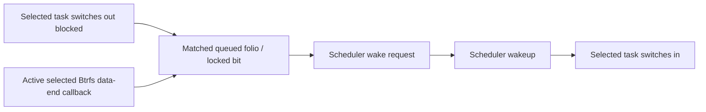

# Stage 1: selected-worker folio wake and scheduler edges

Status: the separate 21-program diagnostic passes 12 native controls. Four cold
worker cases each contain one blocked switch interval with a matched folio wake
and Btrfs data-end callback/range. Four warm cases have no blocked data-read
interval. Deliberately removing folio proof leaves a valid read unresolved and
fails graph quality. This is controlled per-worker causality, not a qualified
device-request chain, whole-application critical path or performance result.

## Extend the reference without changing it

`bench/folio_wait_lineage.bpf.c` includes the frozen
[read-lineage reference](read-lineage.md) and adds explicit wait slots, queue
callback contexts and scheduler events. A checked source derivation creates a
separate loader: it disables the reference's two sleep programs, selects their
two replacements plus queue entry/return and three raw scheduler probes, and
drains seven context maps. There are 21 loaded/attached programs; the original
16-program source, results and binaries remain unchanged.

The runner verifies the prior 11-case qualification, checks 14 actual BTF
function/callback signatures and validates the installed locked-bit and
exclusive-wait encodings. It records and fsyncs extension source hashes,
generated-loader hash, compiled hashes and BTF-header hash before collection.
Unexpected reference-template changes refuse derivation. The new
`bc250-folio-wait-diagnostic` protocol is distinct from the reference and v2
request formats; neither old result is reinterpreted.

## What makes a resolved edge

The selected inherited file object, pinned inode, original Btrfs bios and
data-end contexts retain the reference's positive identity rules. An observed
selected `io_schedule` call creates a private slot keyed by the actual task
object. A matching queue callback must prove all four guards:

1. The queued folio and bit equal the wake key, and the bit is the verified
   locked-folio bit.
2. The folio maps to the pinned selected inode.
3. The queue entry's actual wait task owns the active selected wait slot.
4. The folio's start lies within the active original bio's recorded file range,
   inside that bio's data-end callback.

The range guard is deliberately narrow: large/partial folios outside it remain
unresolved. This is callback/range proof, not a general bio-vector membership
algorithm. Addresses, queue entries and task pointers remain private in
temporary maps. Anonymous IDs and proof bits carry the relationships.

The upstream [page-match helper](https://raw.githubusercontent.com/torvalds/linux/v7.2/include/linux/pagemap.h)
checks both folio and bit. The upstream
[wake function](https://raw.githubusercontent.com/torvalds/linux/v7.2/mm/filemap.c)
can return zero after a successful shared wake and one after a successful
exclusive wake. Its queue entry may be freed before return. The diagnostic
saves entry identity and compares pointer values only at return; it never
dereferences a retired wait entry. Entry proof, supported return semantics and
independent scheduler evidence must agree.

Actual raw `sched_switch`, `sched_waking` and `sched_wakeup` task-object
identities resolve each blocked segment. A nonpreemptive switch with nonzero
saved state is separated from preemption/runnable switches. A resolved segment
requires one positively linked wake request and one wakeup between switch-out
and switch-in. A remote wakeup may lack the waker's current callback context;
its task/wait-slot identity and unique matched wake request still have to agree.
Missing, duplicate, unsupported or contradictory edges remain unresolved.



Three separate diagnostic unions describe switch-out to wake request, wake
delivery and wakeup to switch-in. They sum to observed off-CPU time in these
fully resolved controls; other runnable switches are separate. None is raw
device latency. All include their respective instrumentation/scheduler effects,
and no time from overlapping contexts is summed as application waiting.

## Observed native result

One final-source attempt completed all 12 controls on the recorded BC-250
kernel. It uses the same two new 8 MiB plain/encoded fixture construction and
2 MiB buffered/mmap worker as the reference. Each pair of representations has
identical generated bytes. Worker FNV-1a and full-fixture SHA-256 checks hold.
Cold selected-file data is zero-resident; warm data is fully resident. Host
originals and global caches are never evicted.

| Case | Blocked segments | Resolved folio segments | Matched queue callbacks | Unresolved wait edges |
| --- | ---: | ---: | ---: | ---: |
| plain-read-cold | 1 | 1 | 1 | 0 |
| plain-read-warm | 0 | 0 | 0 | 0 |
| plain-mmap-cold | 1 | 1 | 1 | 0 |
| plain-mmap-warm | 0 | 0 | 0 | 0 |
| compressed-read-cold | 1 | 1 | 1 | 0 |
| compressed-read-warm | 0 | 0 | 0 | 0 |
| compressed-mmap-cold | 1 | 1 | 1 | 0 |
| compressed-mmap-warm | 0 | 0 | 0 | 0 |

All positive streams have closed contexts, no loss, no unresolved selected wake
edge and zero extension error counters. Buffered cold reads exercise shared
wakes with entry flags/return **0/0**; cold mmap cases exercise exclusive wakes
with **1/1**. Every observed switch is nonpreemptive with saved state 258 on this
kernel; that value is reported, not generalized to other kernels.

The same-inode/different-open negative has no selected events. The four-record
cap remains explicitly incomplete, and forced loader exit removes all 21
programs. In the additional folio-proof-disabled cold case, the worker reads
the right bytes and has a blocked interval, but there is no matched folio
callback: one unresolved edge prevents a pass. Timestamp proximity alone
cannot replace the missing identity evidence.

The semantic tests accept a waker return after the owner resumes, using saved
entry state. That ordering was **not observed in these native captures**;
broader actual return-order/nesting/reuse, signals, handoff flags, errors and
capture-boundary cases remain unqualified. The reader rejects unsupported wait
flag contexts instead of guessing their semantics.

## Bounds and reproduction

Captures last three seconds. The seven 4096-entry context maps, 4 MiB ring and
50,000-record cap are temporary and unpinned. The parent has 2 GiB memory,
zero swap, 200% CPU, 128 tasks and a five-minute lifetime. These do not bound
all kernel callback cost. The 72 GiB host free-space floor holds. New private
fixtures, build products and logs add lab writes separate from the production
maintenance ledger. No raw-device write, formatting, power change, boot change or
suspend is attempted.

Independent review recomputes eleven saved raw-capture graphs, checks the known
worker result/bounds, independently checks the scheduler decomposition, and
verifies reference/new sources and binaries. All fixture hashes, seven installed
hashes, original boot configuration, 5000 us policy, enabled active services and
quota history verify. The Linux suite passes **235 tests**.
[Reviewed aggregates](evidence/stage1-folio-wait-lineage.json) retain every case;
private paths, pointers and raw logs stay on the lab host.

```sh
sudo python3 bench/qualify_folio_wait_lineage.py run \
  --reference /absolute/private-lab/qualified-read-lineage \
  --output /absolute/private-lab/new-folio-wait
```

`bench/folio-wait-lineage.schema.json` is structural; the mandatory
`analysis/folio_wait_lineage.py` checks combined delivery, original object
graphs, proof masks, parent ranges and scheduler joins. Exact 64-bit integer
clocks are required. Proof-disabled captures and partial/censored contexts are
not accepted as qualified positive graphs.

Next bridge original/physical Btrfs bios to actual request identities through
splitting/merging and completion/requeue boundaries. Extend adversarial native
coverage and measure the combined diagnostic's added cost before workload use.
The earlier six-program v2 cost result does not qualify this 21-program
extension. Absolute fixture cost, application/frame critical paths, the frozen
full suite and B0/B1/B2 comparisons remain open. No accelerator gain,
architecture choice or default promotion follows from this milestone.
