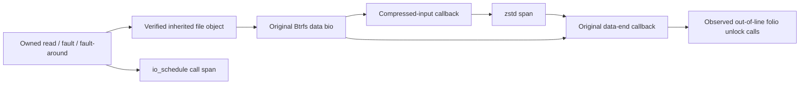

# Stage 1: selected-file Btrfs read and decompression lineage

Status: the final diagnostic passes 11 native controls. Eight positive cold/warm
buffered/mmap cases establish selected-file object lineage. A same-inode wrong
open-description case rejects capture, a record cap is explicitly incomplete,
and forced loader exit removes all 16 programs. This is an opt-in diagnostic,
not a completed storage-critical-path metric or a performance comparison.

## Research direction and target checks

A recent [read-path study](https://arxiv.org/html/2610.10137v2) models waiting
through actual folio–bio–request relationships, preserving splitting, merging
and overlapping work. Its XFS/Linux 6.6.58 cloud experiments motivate measuring
dependencies; their numerical results and tuning choices do not transfer to this
BC-250. The authors describe a planned tool release; this implementation uses
the running target's types and independent controls.

The [upstream filemap path](https://raw.githubusercontent.com/torvalds/linux/v7.2/mm/filemap.c)
includes separate buffered-read, fault and fault-around paths. Btrfs
[compressed-read handling](https://raw.githubusercontent.com/torvalds/linux/v7.2/fs/btrfs/compression.c)
uses an original logical bio and a separate compressed-input container before
decompression and original-bio completion. The
[data-end path](https://raw.githubusercontent.com/torvalds/linux/v7.2/fs/btrfs/extent_io.c)
processes file folios. These upstream files are background, not proof that a
modified kernel body is identical. The runner validates ten actual BTF function
prototypes and compiled CO-RE access against the installed kernel, then proves
the selected live paths with private fixtures.

## Positive identity and asynchronous object links

The controller opens a new private regular file read-only and passes its actual
open file description to a paused owned worker. Parent and worker retain their
descriptors until the diagnostic detaches. For each selected buffered read,
fault or fault-around attempt, BPF resolves the configured descriptor through
that worker's real file table and requires exact file-object equality with the
function argument. It then learns the pinned kernel inode privately.
No path, maps-device value, inode number alone or issuer PID is used to assign
asynchronous callbacks to the file. A separate open of the **same inode** fails
the file-object check and yields no selected records.

Original Btrfs read bios are tagged at submission using that pinned inode.
Anonymous IDs carry the observed origin demand to compressed-input completion,
zstd entry/return and the original data-end callback. Decompression and end
callbacks can execute in another task. Return probes use saved entry contexts
and do not dereference a bio/container that the called function may have freed.
Original-bio keys are removed at data-end entry; saved anonymous return state
keeps that lifetime distinct from later pointer reuse. This design is not a
qualification of every reuse/nesting/error interleaving.



The diagram shows observed object/context relationships. It does not connect a
specific sleeping folio to device requests. Btrfs compressed-input completion
includes filesystem completion processing; its timestamp is not raw NVMe
completion. `io_schedule` wall spans include scheduling effects, and zstd wall
spans include preemption/interrupt effects. They are not pure device wait or
decompression CPU time. The reader uses interval unions rather than summing
overlapping spans.

## Native controls and coverage discovery

Two new 8 MiB regular fixtures contain identical generated bytes. One is NOCOW
with unencoded unshared extents; the other has native Btrfs encoded unshared
extents and exercises zstd. Each worker reads/hashes a 2 MiB prefix by buffered
pread or mmap. Worker FNV-1a verifies the observed bytes; whole-fixture SHA-256
checks before/after verify unchanged stored contents. File-specific residency
checks require zero copied-data pages for cold and all 8 MiB for warm. Only
these private files are evicted; no global or original-file cache reset occurs.

| Case | Buffered attempts | Fault attempts | Fault-around attempts | Original bios | zstd spans | io_schedule spans |
| --- | ---: | ---: | ---: | ---: | ---: | ---: |
| plain-read-cold | 1 | 0 | 0 | 2 | 0 | 1 |
| plain-read-warm | 1 | 0 | 0 | 0 | 0 | 0 |
| plain-mmap-cold | 0 | 1 | 33 | 4 | 0 | 1 |
| plain-mmap-warm | 0 | 0 | 32 | 0 | 0 | 0 |
| compressed-read-cold | 1 | 0 | 0 | 16 | 16 | 1 |
| compressed-read-warm | 1 | 0 | 0 | 0 | 0 | 0 |
| compressed-mmap-cold | 0 | 1 | 33 | 32 | 32 | 1 |
| compressed-mmap-warm | 0 | 0 | 32 | 0 | 0 | 0 |

All eight positive streams are complete, all selected bio origins resolve,
and every recorded selected context closes. The four warm cases have no data
bio or decompression event. Across cold cases, 54 original bios, 48 zstd spans
and 3,072 out-of-line unlock calls are linked. BIO counts include speculative
readahead and are not demanded bytes, physical requests or read amplification.
The observed unlock hook is not a census of inlined unlock operations; absence
of its events does not prove that no unlock occurred.

The first attempt failed compilation because a local struct tag collided with
the actual kernel BTF namespace, before attaching. The second passed three
cases but correctly failed demand coverage on a successful warm mmap worker:
fault-around had skipped `filemap_fault`. The final source adds verified
`filemap_map_pages` entry/return and records 32 warm fault-around attempts in
each representation. Earlier attempts remain retained and are not rewritten.

All cases count non-target descriptor rejections separately from lost/unknown
selected lineage. Normal cases record three or four such rejections. The
same-inode negative records five and no selected event. The four-record cap
reports its partial capture rather than a passing graph; SIGKILL of the idle
loader removes every owned program before the pinned worker is released.

## Protocol, bounds and remaining gates

`bench/read-lineage.schema.json` is the structural format;
`analysis/read_lineage.py` is mandatory for delivery accounting, lifecycle and
parent/interval proof. Preserve exact 64-bit integer clocks. The separate
`bc250-read-lineage-diagnostic` protocol exports anonymous IDs and numeric
diagnostic payloads, with no pointers, task IDs, paths or physical sectors.
Raw captures and file details stay private; [reviewed aggregates](evidence/stage1-read-lineage.json)
retain all 11 cases and the three attempts. This does not reinterpret v1/v2
request captures or their overhead results.

Each capture lasts three seconds with 16 temporary unpinned programs, five
4096-entry context maps, a 4 MiB ring and at most 50,000 saved records. The
parent has 2 GiB memory, no swap, 200% CPU, 128 tasks and a five-minute limit.
These are parent/collector limits, not a bound on all kernel callback cost.
The 72 GiB free-space floor holds. Three retained attempts add lab space/writes,
separate from production maintenance charges. No device format, raw-device
write, power-policy change, boot change or suspend is performed.

Independent review recomputes ten saved capture graphs, checks known worker
results and original bounds, verifies sources/binaries and fixture hashes, and
confirms the working installation's seven hashes, original boot configuration,
5000 us policy, active enabled services and retained quota history. The Linux
suite passes **225 tests**; CI additionally compiles the inherited-descriptor
worker with warnings as errors.

```sh
sudo python3 bench/qualify_read_lineage.py run \
  --output /absolute/private-lab/new-read-lineage
```

Next join exact folio wait/wake dependencies to the original/physical bio and
request graph, including splitting/merging, retries and censored lifetimes.
Extend errors, callback nesting, loss/reuse and adversarial boundary controls,
then measure the added instrumentation cost before attaching it to workload
endpoints. The qualified cost of the separate six-program v2 observer does not
qualify this 16-program diagnostic. Absolute fixture cost, application-level
critical-path waiting, the full suite and B0/B1/B2 comparisons remain open.
No accelerator architecture or default is promoted.
